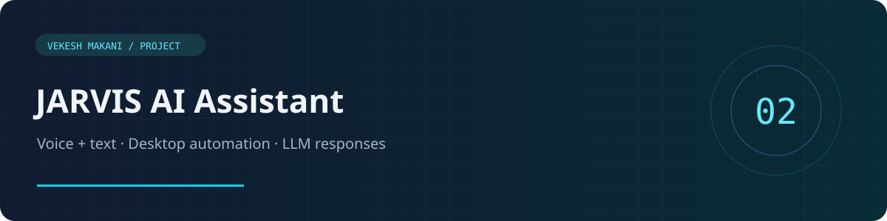
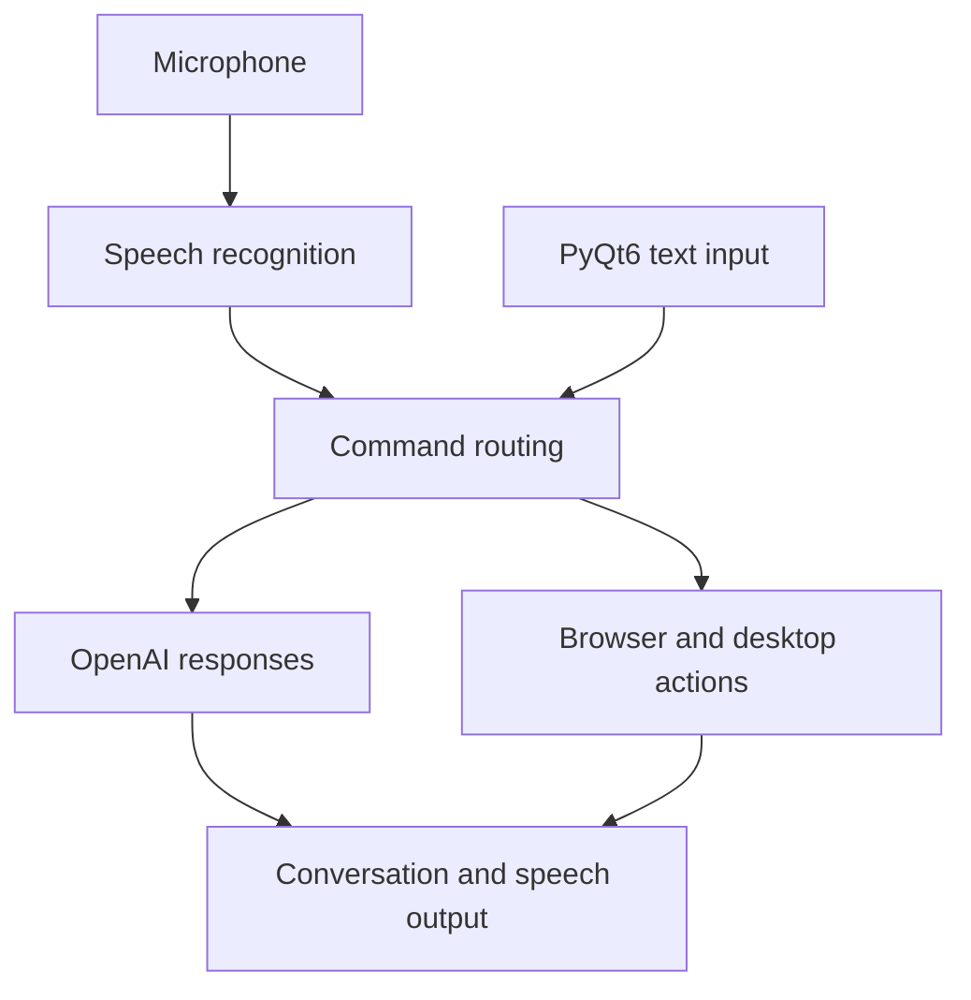

<div align="center">



**A desktop assistant that listens, responds, and takes action.**

`Python` · `PyQt6` · `SpeechRecognition` · `pyttsx3` · `OpenAI`

[Portfolio](https://vekeshportfolio.lovable.app/) · [Developer profile](https://github.com/Vekesh04)

</div>

## Overview

JARVIS combines voice recognition, text input, spoken responses, and desktop automation in a Python application. A PyQt6 interface provides a conversation view while a background thread listens for voice commands.

## Highlights

- Wake-word activation using **Jarvis** and voice-controlled listening states.
- Voice and text interaction through a desktop GUI.
- Open common websites, search supported platforms, and launch applications.
- Play YouTube content using `pywhatkit`.
- Generate conversational responses through the OpenAI API.
- Read responses aloud with text-to-speech.

## Architecture



## Run locally

Use Python 3.10+ and a desktop session with microphone access.

```bash
python -m venv .venv
```

Activate it with `source .venv/bin/activate` on macOS/Linux or `.venv\Scripts\activate` on Windows.

```bash
python -m pip install -r requirements.txt
```

Copy `.env.example` to `.env`, set your own `OPENAI_API_KEY`, then launch the main GUI:

```bash
python jarvis.py
```

PyAudio may require PortAudio development libraries. Speech recognition, YouTube playback, and LLM responses need internet access. OpenAI usage requires your own account and may incur charges.

## Try these commands

- “Jarvis” to wake the assistant.
- “Open Google” or “open YouTube”.
- “Play relaxing music”.
- “Search for Python tutorials on YouTube”.
- “Go to sleep” to stop active listening.

## Repository guide

| File | Purpose |
| --- | --- |
| `jarvis.py` | Integrated GUI, speech thread, command routing, and LLM responses |
| `main.py` | Earlier Windows-oriented console implementation |
| `temp1.py` | Alternate command-processing implementation |
| `temp2.py` | Earlier GUI implementation using `temp1.py` |
| `.env.example` | API-key configuration template |

## Development notes

This is a desktop prototype, not an always-on background service. Application names, installed paths, microphone drivers, and speech engines vary by operating system. The Windows registry fallback in `jarvis.py` needs platform-specific testing. API keys, local environments, and disposable scripts have been excluded from the public source.

## Author

**Vekesh Makani** · AI Engineer & Python Developer

[Portfolio](https://vekeshportfolio.lovable.app/) · [LinkedIn](https://linkedin.com/in/vekesh-m)
